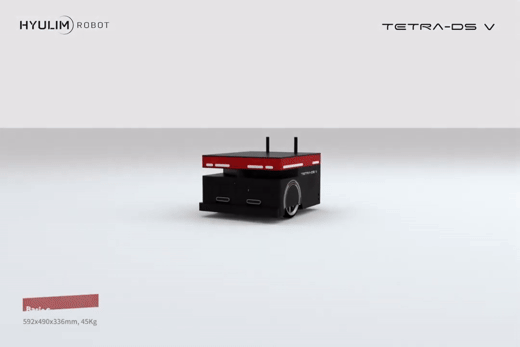
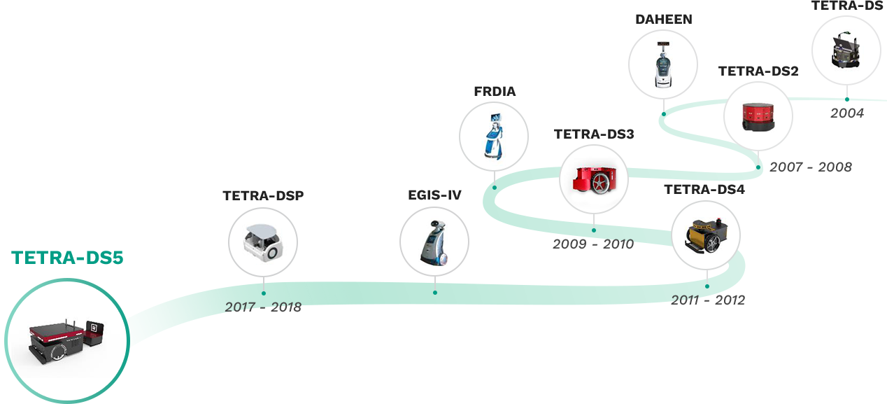

<!--
  TETRA-ROBOT 조직 소개 페이지 (.github/profile/README.md)
  사양 수치 출처: 모델별 사양서(2024-10-29), 회사 소개자료(2026-08)
  사양·연락처를 고치면 맨 아래 English 요약도 함께 고쳐 주세요.
-->

<div align="center">

# TETRA-DSV

**현장에 맞춰 구성하는 ROS 기반 맞춤형 자율주행 이동로봇(AMR)**


🏆 **WIS 2022 과학기술정보통신부 장관상** 수상



[라인업](#라인업) · [개발 시작하기](#개발-시작하기) · [문서](#문서) · [문의](#문의) · [English](#english)

</div>

**TETRA-DSV**(TETRA-DS V, DS5)는 (주)휴림에이텍 로봇사업부가 만드는 **맞춤형 자율주행 이동로봇(AMR, Autonomous Mobile Robot) 플랫폼**입니다. 2004년 TETRA-DS부터 20여 년간 이어 온 자율주행 연구로 완성했으며, 범용 로봇 운영체제 [ROS](https://www.ros.org/) 기반이라 현장 환경과 고객 요구에 맞춰 구성하고 다양한 애플리케이션으로 확장할 수 있습니다. 교육·연구용부터 1 t급 무인 운반까지, 물류창고·제조공장·연구실과 일반 실내 공간에서 쓰입니다.

이 조직에서 모델별 ROS 패키지와 연동 API·매뉴얼을 공개합니다.

## 한눈에 보기

| 항목 | 내용 |
|:--|:--|
| 라인업 | 교육용 EDU부터 소형 S, 범용 M, 중량물용 MH·H까지 · 적재 30 kg ~ 1 t |
| 자율주행 | 2D SLAM 매핑·내비게이션, 실시간 경로 생성으로 장애물 회피 |
| 구동·센서 | 2륜 차동 구동(PMSM AC 서보) · 2D LiDAR · RGB-D 카메라 · IMU · 범퍼·비상정지(EMG) |
| 충전 | 자동 충전 스테이션 (도킹 오차 ±1 cm) |
| 소프트웨어 | ROS 2 Jazzy · Ubuntu 24.04 (권장)<br>ROS 1 Melodic · Ubuntu 18.04 (기존 시스템) |
| 관제·연동 | PC·모바일 싱글관제 앱 · REST API · Socket.IO 실시간 이벤트 |
| 수상 | 과학기술정보통신부 장관상 (WIS 2022 혁신상)<br>산업통상자원부 장관상 (기계항공산업발전 유공, 2022·2024) |

<sub>모델·구성에 따라 사양이 다릅니다. EDU는 RGB-D 카메라·IMU·자동 충전이 옵션입니다.</sub>

## 라인업

| 모델 | 특징 | 최대 적재 | 최고 속도 | ROS 2 Jazzy (권장) | ROS 1 Melodic |
|:--|:--|--:|--:|:--|:--|
| **EDU** | 교육·연구용 | 60 kg | 1.5 m/s | [TETRA_ROS2_EDU](https://github.com/TETRA-ROBOT/TETRA_ROS2_EDU) | — |
| **S** | 소형·고속형 | 30 kg | 2.0 m/s | [TETRA_ROS2_S](https://github.com/TETRA-ROBOT/TETRA_ROS2_S) | [TETRA-DSV_S](https://github.com/TETRA-ROBOT/TETRA-DSV_S) |
| **M** | 범용 기본형 | 100 kg | 1.5 m/s | [TETRA_ROS2_M](https://github.com/TETRA-ROBOT/TETRA_ROS2_M) | [TETRA-DSV_M](https://github.com/TETRA-ROBOT/TETRA-DSV_M) |
| **MH** | 중량물 운반형 | 250 kg | 1.5 m/s | — | [TETRA-DSV_MH](https://github.com/TETRA-ROBOT/TETRA-DSV_MH) |
| **H** | 대형 중량물 운반형 | 300 kg ~ 1 t | 1.2 m/s | — | [TETRA-DSV_H](https://github.com/TETRA-ROBOT/TETRA-DSV_H) |

<sub>적재량은 평지 기준이며, H는 구동 모터 구성(200 W·400 W)에 따라 적재량과 속도가 달라집니다.<br>
연속 운용 시간은 EDU 약 3.5시간, S 약 4시간, M 약 8시간입니다(PC 사양·주행 조건에 따라 다름).<br>
표에 없는 모델(SM 등)이나 현장 맞춤 사양은 [문의](#문의)해 주세요.</sub>

> [!TIP]
> 새로 개발한다면 **ROS 2 Jazzy**(Ubuntu 24.04) 저장소를 쓰세요. ROS 1 Melodic(Ubuntu 18.04)은 2023년 5월에 공식 지원이 끝나 기존 시스템 유지보수용으로만 권장합니다. MH·H의 ROS 2 패키지는 문의해 주세요.

## 개발 시작하기

> [!CAUTION]
> **로봇을 움직이는 코드를 실행하기 전에 꼭 읽어 주세요.**
> - 비상시에는 로봇의 **EMG(비상정지) 버튼**을 누르세요. API의 주행 취소(`PUT /nav/cancel`)는 안전 장치를 대신하지 않습니다.
> - 로봇 API(REST·Socket.IO)는 설정에 따라 인증 없이 호출될 수 있습니다. 로봇은 외부망과 분리된 네트워크(전용 AP·VLAN)에서 운용하고, 80번 포트를 인터넷에 열지 마세요.
> - 속도 명령(`robot:cmd_velocity`)은 다음 명령이 올 때까지 유지될 수 있습니다. 멈출 때는 반드시 0 속도를 보내세요.
> - 처음에는 주변을 비우고 0.1 m/s 이하로 시험하세요. 명령은 앱·관제 서버·직접 만든 코드 중 한 곳에서만 보내세요.

### ROS 2로 개발하기

Ubuntu 24.04에 [ROS 2 Jazzy](https://docs.ros.org/en/jazzy/Installation/Ubuntu-Install-Debs.html)를 설치한 로봇 PC에서 진행합니다. 아래는 M 모델 기준이며, S·EDU는 저장소 이름만 바꾸면 됩니다.

```bash
# 1. 센서 장치 권한 (다시 로그인해야 적용됩니다)
sudo usermod -aG dialout $USER

# 2. 워크스페이스에 내려받기
source /opt/ros/jazzy/setup.bash
mkdir -p ~/ros2_ws && cd ~/ros2_ws
git clone https://github.com/TETRA-ROBOT/TETRA_ROS2_M.git src

# 3. 의존성 설치와 빌드 (rosdep·colcon이 없다면: sudo apt install ros-dev-tools)
# sudo rosdep init   # rosdep을 처음 쓰는 PC라면 한 번만
rosdep update
rosdep install --from-paths src --ignore-src -r -y
colcon build --symlink-install
source install/setup.bash

# 4. 로봇 기동 (구동·센서·서비스 노드를 한 번에 실행)
ros2 launch tetra_bringup tetra_bringup.launch.py
```

LiDAR IP와 DDS(Cyclone DDS) 설정 등 자세한 절차는 각 저장소 README와 [EDU ROS 2 세팅 매뉴얼](./docs/ros/TETRA-EDU_Menual_ROS2.pdf)을 참고하세요.

### API로 연동하기: 5분 연결 테스트

로봇이 움직이지 않는 **읽기 전용** 테스트입니다. PC를 로봇과 같은 네트워크에 연결하고, 예시의 `192.168.50.2`를 로봇 IP로 바꿔 실행하세요.

**1. REST API로 현재 모드 확인**

```bash
curl http://192.168.50.2/mode
# 응답 예: {"mode":"NAV"}
```

**2. Socket.IO로 실시간 배터리 받기** · 로봇은 Socket.IO 4(4.7.2)를 씁니다. 일반 WebSocket 클라이언트로는 연결되지 않습니다.

```bash
npm install socket.io-client@4
```

```js
// battery.mjs (실행: node battery.mjs, 종료: Ctrl+C)
import { io } from "socket.io-client";

const socket = io("http://192.168.50.2");
socket.on("connect", () => console.log("연결됨"));
socket.on("robot:battery", (data) => console.log("배터리:", data.battery));
```

전체 엔드포인트와 이벤트 목록은 아래 [문서](#문서)의 REST API 명세와 WebSocket(Socket.IO) 이벤트 명세에 있습니다.

## 문서

| 분류 | 문서 | 기준일 | 링크 |
|:--|:--|:--|:--|
| 사양 | M 사양서 | 2024-10-29 | [보기](./docs/spec/m/TETRA_DSV_M_specifications_241029.pdf) · [받기](https://raw.githubusercontent.com/TETRA-ROBOT/.github/main/profile/docs/spec/m/TETRA_DSV_M_specifications_241029.pdf) |
| 사양 | S 사양서 | 2024-10-29 | [보기](./docs/spec/s/TETRA_DSV_S_specifications_241029.pdf) · [받기](https://raw.githubusercontent.com/TETRA-ROBOT/.github/main/profile/docs/spec/s/TETRA_DSV_S_specifications_241029.pdf) |
| 하드웨어 | Control Hardware Protocol 매뉴얼 | 2024-10-29 | [보기](./docs/protocol/TETRA_DSV_control_hardware_protocol_241029.pdf) · [받기](https://raw.githubusercontent.com/TETRA-ROBOT/.github/main/profile/docs/protocol/TETRA_DSV_control_hardware_protocol_241029.pdf) |
| ROS | ROS 1 Melodic 매뉴얼 | 2024-10-29 | [보기](./docs/ros/TETRA_DSV_ros_melodic_menual_241029.pdf) · [받기](https://raw.githubusercontent.com/TETRA-ROBOT/.github/main/profile/docs/ros/TETRA_DSV_ros_melodic_menual_241029.pdf) |
| ROS | EDU ROS 2 Jazzy 세팅 매뉴얼 | 2026-10-08 | [보기](./docs/ros/TETRA-EDU_Menual_ROS2.pdf) · [받기](https://raw.githubusercontent.com/TETRA-ROBOT/.github/main/profile/docs/ros/TETRA-EDU_Menual_ROS2.pdf) |
| 연동 | REST API 명세 (v0.3.3) | 2024-10-24 | [보기](./docs/restapi/tetra_single_api_20241024.pdf) · [받기](https://raw.githubusercontent.com/TETRA-ROBOT/.github/main/profile/docs/restapi/tetra_single_api_20241024.pdf) |
| 연동 | REST API 예제 (C++) | 2024-10-29 | [보기](./docs/restapi/ex_20241029.md) |
| 연동 | WebSocket(Socket.IO) 이벤트 명세 (로봇 SW 0.3.8) | 2025-02-14 | [보기](./docs/websocket/websocket_20250214.md) |
| 앱 | 싱글관제 앱 매뉴얼 | 2024-10-28 | [보기](./docs/app/TETRA-DSV_Controller_Manual_v241028.pdf) · [받기](https://raw.githubusercontent.com/TETRA-ROBOT/.github/main/profile/docs/app/TETRA-DSV_Controller_Manual_v241028.pdf) |
| 앱 | 싱글관제 앱 (Android APK) | 2026-08-28 | [받기](https://raw.githubusercontent.com/TETRA-ROBOT/.github/main/profile/app/tetra_260828.apk) |

## 문의

| 용도 | 연락처 |
|:--|:--|
| 도입·견적 | [robotsales@hyulimatech.co.kr](mailto:robotsales@hyulimatech.co.kr) · 070-4107-9994 |
| 기술 질문 | [GitHub Discussions](https://github.com/TETRA-ROBOT/.github/discussions) (버그 제보는 각 저장소 Issues) |
| 홈페이지 | [www.hyulimatech.co.kr](https://www.hyulimatech.co.kr) |
| YouTube | [채널 바로가기](https://www.youtube.com/channel/UCZTXzgIu6t9ZUQBHAdPTGMg) |

## 연혁

2004 **TETRA-DS** → 2007–2008 **DS2** → 2009–2010 **DS3** → 2011–2012 **DS4** → 2017–2018 **DSP** → **TETRA-DSV (DS5)**

<details>
<summary>연혁 이미지 보기</summary>



</details>

## English

**TETRA-DSV** is a customizable, ROS-based autonomous mobile robot (AMR) platform developed by the Robotics Division of HYULIM A-TECH, Korea. It continues the TETRA-DS series that began in 2004.

- Lineup from the TETRA-EDU education platform to the heavy-duty TETRA-DSV-H, with payloads from 30 kg to 1 t
- ROS 2 Jazzy (Ubuntu 24.04) recommended; ROS 1 Melodic (Ubuntu 18.04) for existing systems
- 2D SLAM navigation, automatic charging station (±1 cm docking), REST and Socket.IO APIs (keep robots on an isolated network)
- Find your model's repository in the [lineup table](#라인업) · Sales: [robotsales@hyulimatech.co.kr](mailto:robotsales@hyulimatech.co.kr)
